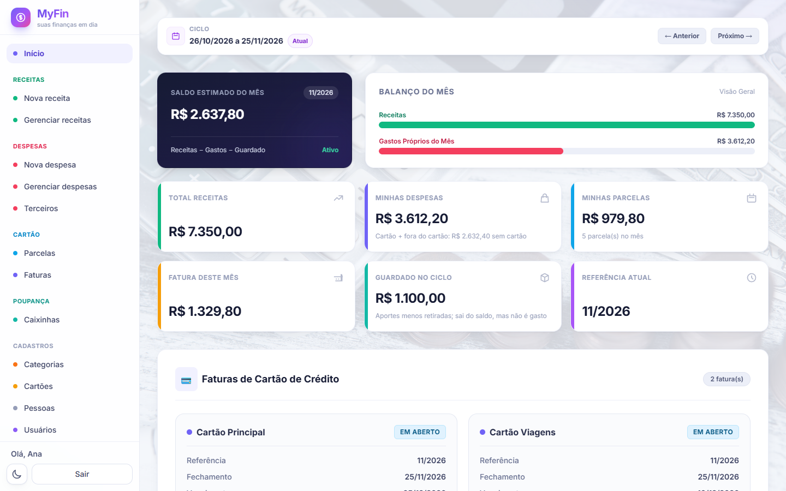
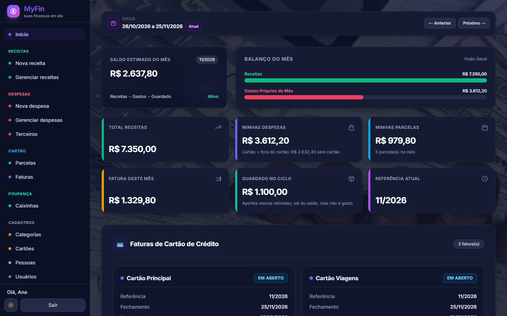
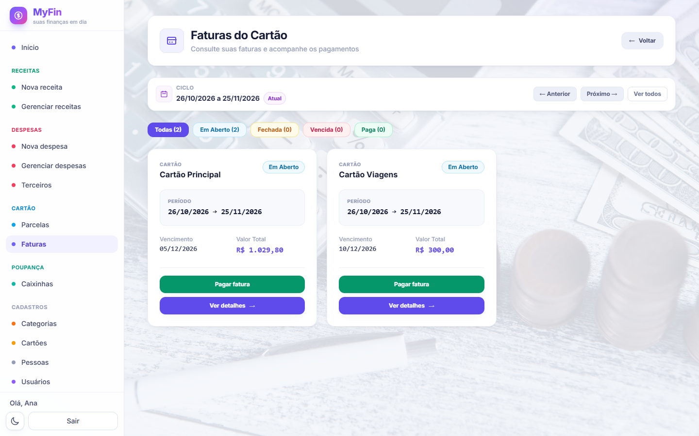
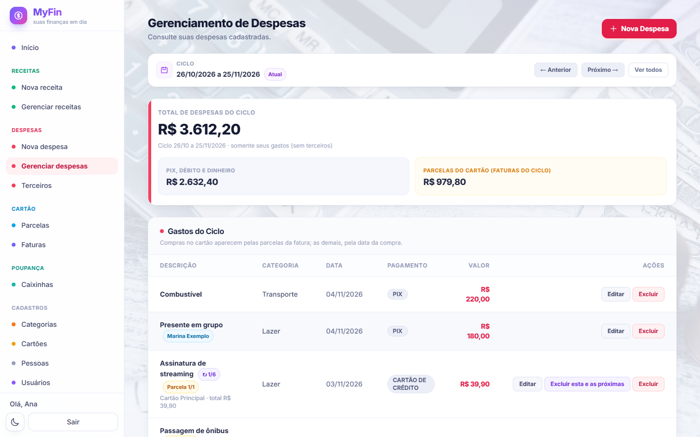
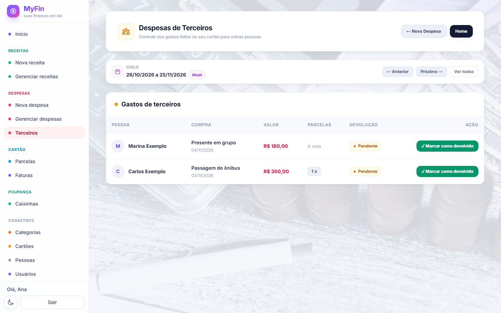
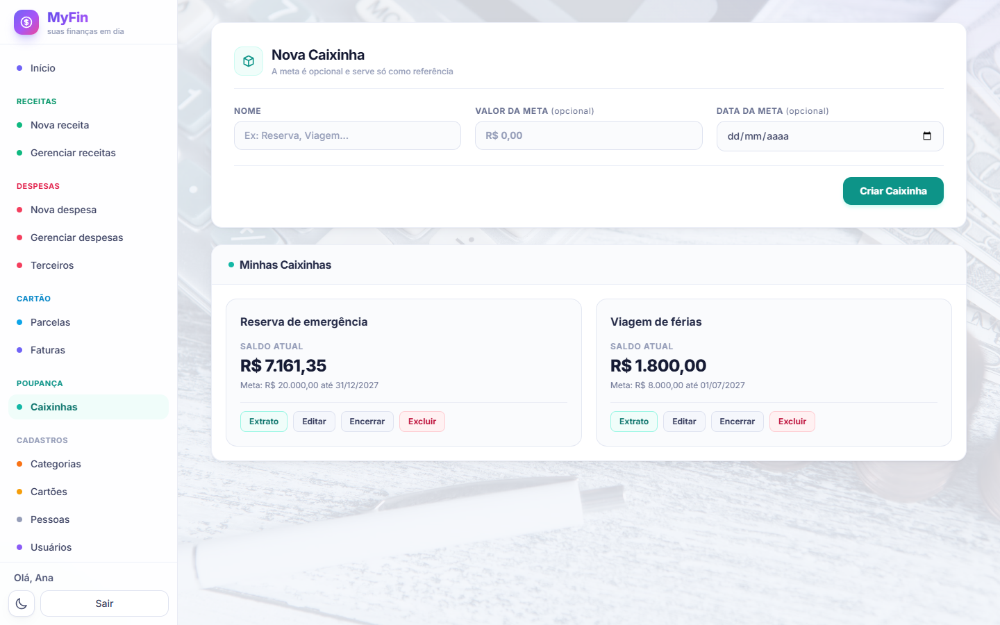
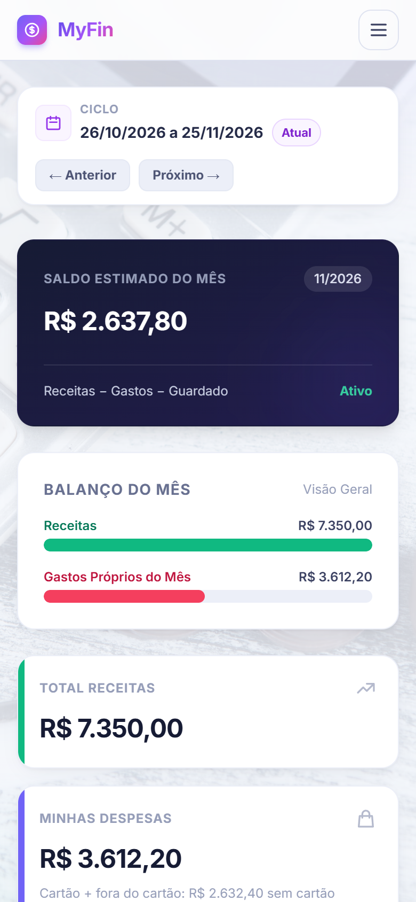
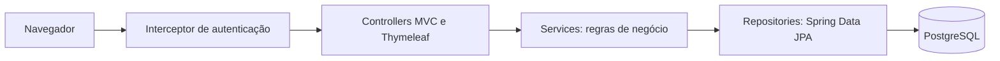

# MyFin: controle financeiro pessoal

Sistema web para organizar a vida financeira em um só lugar: receitas, despesas, cartões de crédito, faturas, parcelas, gastos feitos para outras pessoas e poupança. Cada usuário acessa com login próprio e vê apenas os seus dados.

> Este repositório é apenas uma vitrine do projeto. O código-fonte é mantido em um repositório privado.

## Telas

*As imagens usam apenas dados fictícios, criados em um banco local só para esta demonstração.*

**Painel inicial**

| Tema escuro | Faturas do cartão |
| --- | --- |
|  |  |

| Despesas do ciclo | Gastos de terceiros |
| --- | --- |
|  |  |

| Poupança | Versão para celular |
| --- | --- |
|  |  |

## Funcionalidades

- **Receitas e despesas**, com categorias e lançamentos recorrentes.
- **Cartões de crédito:** compras parceladas viram parcelas nas faturas certas, respeitando o dia de fechamento de cada cartão.
- **Faturas:** cálculo automático do total e do status, com opção de pagar ou desfazer o pagamento.
- **Ciclo financeiro:** as telas de listagem e os totais podem ser filtrados pelo ciclo mensal escolhido.
- **Gastos de terceiros:** separa o que é seu do que outra pessoa precisa devolver.
- **Poupança:** caixinhas com meta opcional e extrato de aportes, retiradas e rendimentos.
- **Usuários:** convite, primeiro acesso e dados isolados por usuário.
- **Interface:** tema claro e escuro, com menu adaptado ao celular.

## Tecnologias

| Camada | Tecnologias |
| --- | --- |
| Backend | Java 17, Spring Boot 4.1 (Web MVC, Data JPA, Validation), Hibernate |
| Frontend | Thymeleaf, Tailwind CSS, JavaScript |
| Banco de dados | PostgreSQL (Neon em produção) |
| Testes | JUnit, Spring Boot Test |
| Infraestrutura | Docker (build multi-stage), Render, GitHub Actions |

## Arquitetura

Aplicação monolítica, com telas renderizadas no servidor e organizada em camadas:

## Decisões técnicas

- **Isolamento de dados:** as entidades de cada usuário usam `@TenantId` do Hibernate, então as consultas são filtradas pelo usuário da sessão, inclusive `findById`.
- **Segurança:** senhas com hash BCrypt, token CSRF próprio, bloqueio após tentativas de login incorretas e cookie de sessão `Secure` em produção. A autenticação foi implementada com interceptor e sessão HTTP, sem o Spring Security completo.
- **Valores monetários:** uso de `BigDecimal`. Ao dividir uma compra, a última parcela recebe o resto do arredondamento, para a soma bater com o total.
- **Saldo da poupança:** é calculado a partir das movimentações, sem ficar gravado, e a validação trava a caixinha para evitar saldo total negativo.
- **Hospedagem com poucos recursos:** a imagem Docker gera um cache de classes (CDS) para acelerar a subida, e o pool de conexões não mantém conexões ociosas, o que permite ao banco desligar quando não há uso.

## Sobre o desenvolvimento

Projeto pessoal desenvolvido por [Gabriel Marinho](https://github.com/Marinhuuu), com apoio de ferramentas de IA em parte da implementação.

## Direitos

© 2026 Gabriel Marinho. Todos os direitos reservados. Veja [LICENSE](LICENSE).
